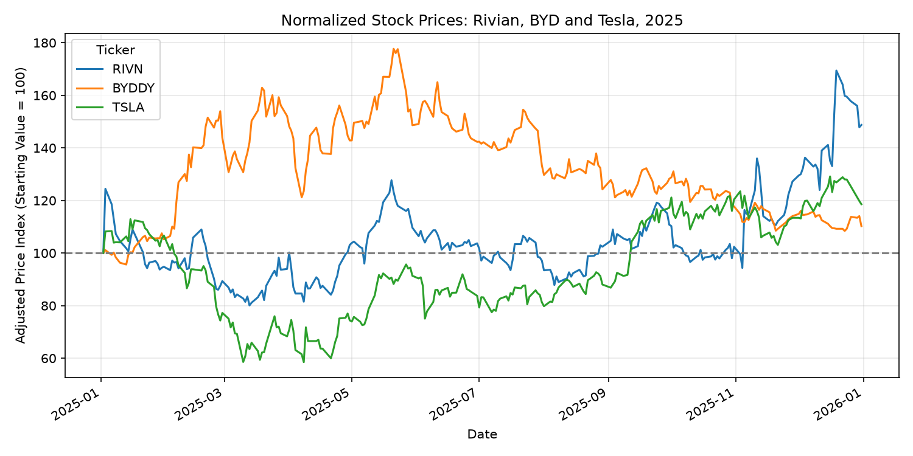
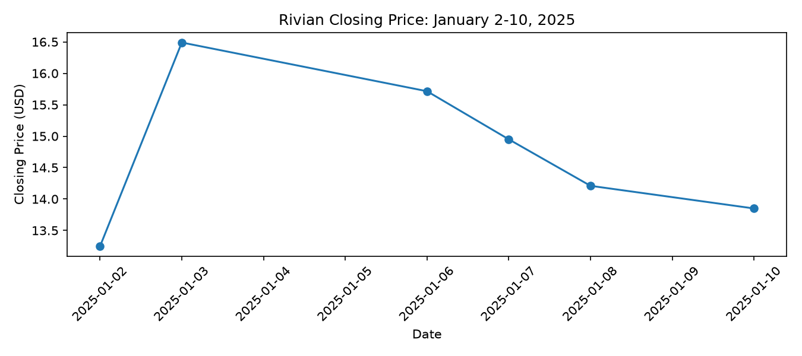
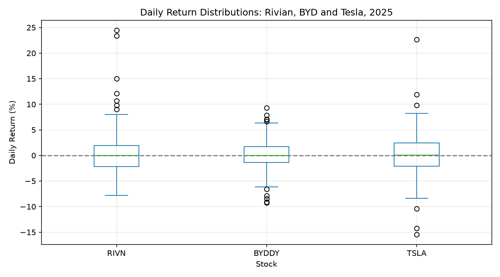
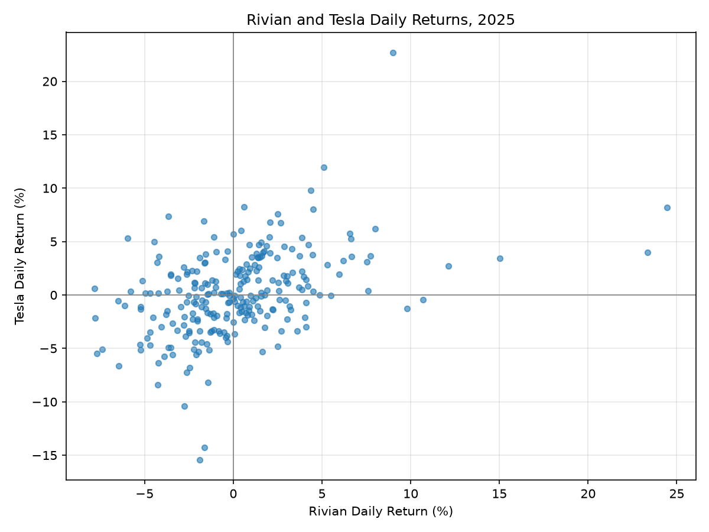

# EV Stock Analysis: Rivian, BYD and Tesla

## Group members and contributions

- **Quanyin Li (Quanyin1211):** Rivian analysis, cross-stock comparisons, README writing and repository integration.
- **Jeffery (pengze-oss):** BYD and Tesla analysis, including data preparation, statistics, monthly summaries, charts, supplementary event analysis, business explanations and sources.

## Business questions

We compare three electric-vehicle companies to ask: How did their stock performance and daily volatility differ in 2025? Did their daily returns move together? What business or policy news may help explain large movements?

| Company | Yahoo Finance ticker | Security used |
|---|---|---|
| Rivian | RIVN | U.S. stock |
| BYD | BYDDY | U.S.-traded ADR |
| Tesla | TSLA | U.S. stock |

All three compete in the EV industry, but differ in product mix, markets and business scale. BYDDY lets us compare USD-denominated securities on U.S. trading dates. It is not BYD's Hong Kong or Shenzhen listing.

## Data and methods

- Requested range: **2025-01-01 to 2026-01-01**, with the end date excluded by yfinance.
- Actual saved observations: **January 2-December 31, 2025**, with **250 price records per stock**.
- Source: Yahoo Finance, downloaded with `yfinance.download()`.
- Tools: Python, yfinance, pandas and Matplotlib.
- Price statistics and event extrema use the returned `Close` column. Percentage returns and normalized comparisons use `Adj Close`.
- Daily return = `(current adjusted close / previous adjusted close - 1) * 100`.
- Each stock has 249 valid daily returns. The first sample row has no earlier price for a return calculation. The six downloaded price/volume fields have no missing values in the saved data.
- The comparison uses 249 dates with valid returns for all three stocks, without filling missing returns. Correlations are Pearson correlations.
- Monthly summaries use pandas `resample("ME")`. The original BYD/Tesla monthly CSVs report month-end closes; `byd_tesla_event_output.txt` and `rivian_output.txt` report monthly mean closes. These are different measures and are labeled separately.

## Main findings

| Stock | Ending normalized adjusted price | Change from Jan 2 to Dec 31 | Daily return standard deviation |
|---|---:|---:|---:|
| Rivian | 148.75 | +48.75% | 4.084 percentage points |
| BYD | 110.24 | +10.24% | 2.841 percentage points |
| Tesla | 118.57 | +18.57% | 3.988 percentage points |

1. **Rivian had the largest adjusted-price increase** over this comparison period. Its late-year rise mattered to the result, even though much of its January event gain reversed.
2. **BYD had the lowest daily return standard deviation.** Rivian's was slightly higher than Tesla's, showing that the largest period gain came with substantial daily variation.
3. **Rivian and Tesla moved together more closely than either did with BYD.** Their daily-return correlation was 0.424, compared with 0.162 for Rivian-BYD and 0.200 for BYD-Tesla. These are positive associations, not evidence that one stock causes another to move.
4. **Large single-day movements did not always persist.** Rivian's +24.45% day left a +4.53% window gain; Tesla's +22.69% day was followed by declines, leaving +8.15% over its window. BYD's selected window instead continued downward, ending -16.29%.

### Daily return correlation

| | RIVN | BYDDY | TSLA |
|---|---:|---:|---:|
| RIVN | 1.000 | 0.162 | 0.424 |
| BYDDY | 0.162 | 1.000 | 0.200 |
| TSLA | 0.424 | 0.200 | 1.000 |

## Significant movements and business explanations

### Rivian: January 2-10, 2025

The lowest close in the window was **$13.25 on January 2** and the highest was **$16.49 on January 3**. The January 3 return of **+24.45%** was the largest positive daily return in Rivian's 2025 sample. Volume reached **124,581,800 shares**, about **3.60 times** the annual median of **34,630,100**. By January 10, the close was $13.85 and the window gain was **4.53%**.

Rivian's January 3 release reported 2024 deliveries of 51,579 vehicles, within its guidance of 50,500-52,000, and said a component shortage was no longer limiting production. Better expectations about operational execution are a plausible explanation for the positive reaction. The timing and volume support this interpretation, but the subsequent reversal shows the initial gain was not fully sustained. [Source: Rivian release, January 3, 2025](https://www.sec.gov/Archives/edgar/data/1874178/000187417825000002/ex-9914q24deliveryproducti.htm).

### BYD: May 23-30, 2025

BYDDY's highest close in the window was **$19.71 on May 23** and its lowest was **$16.50 on May 30**. The **-9.25%** return on May 27 was its largest daily decline in the 2025 sample. Volume was **8,905,200 shares**, about **3.59 times** the annual median of **2,478,600**. The adjusted-price decline over the window was **16.29%**.

Reuters reported new BYD incentives on more than 20 models and concerns about China's auto price war. Discounts may support sales while putting pressure on margins, a plausible reason for a negative stock reaction. [Source: Reuters, May 26 report, updated May 27, 2025](https://www.reuters.com/business/autos-transportation/china-auto-shares-sink-after-byd-offers-trade-in-incentives-2025-05-26/).

The Reuters article discusses Hong Kong-listed shares. Our **-9.25%** figure is calculated separately for the U.S. ADR on **May 27**. May 26 was the U.S. Memorial Day market holiday, explaining why the next U.S. observation follows the Hong Kong reaction. [Source: NYSE holiday calendar](https://ir.theice.com/press/news-details/2024/NYSE-Group-Announces-2025-2026-and-2027-Holiday-and-Early-Closings-Calendar/default.aspx). High volume and further declines are consistent with concerns about competitive pressure, but do not isolate the effect of the incentives from other news.

### Tesla: April 7-11, 2025

Tesla's lowest close in the window was **$221.86 on April 8** and its highest was **$272.20 on April 9**. Its **+22.69%** return on April 9 was the largest daily gain in the 2025 sample. Volume reached **219,433,400 shares**, about **2.36 times** the annual median of **92,842,400**. The close fell to **$252.31 on April 11**, leaving an **8.15%** gain from April 7.

On April 9, the U.S. announced a 90-day suspension of higher country-specific reciprocal tariff rates for most trading partners, retaining a 10% rate for those partners. China was excluded, and the order did not remove all tariffs. [Source: Executive Order 14266, April 9, 2025, sections 1-2](https://www.govinfo.gov/content/pkg/DCPD-202500459/html/DCPD-202500459.htm). Reuters reported a broad technology-stock rally after the announcement. [Source: Reuters, April 9 report, updated April 10, 2025](https://www.reuters.com/technology/magnificent-seven-add-more-than-1-trillion-value-after-trump-pauses-some-tariffs-2025-04-09/).

Relief about trade-policy uncertainty is a plausible explanation for Tesla's rebound. The high volume supports an unusually active session. Because the rally was market-wide and partly reversed, this event is not evidence of a sudden improvement in Tesla's operating results.

## Required visualizations

### 1. Full-period comparison



Starting each stock at 100 shows period gains of approximately 48.75% for Rivian, 18.57% for Tesla and 10.24% for BYD, despite different paths during the year.

### 2. Significant-event zoom



Rivian jumped 24.45% on January 3 but ended January 10 only 4.53% above January 2, showing that much of the initial gain reversed.

### 3. Return distribution comparison



The boxplots show typical return spreads and extreme observations; daily standard deviations were 4.084 percentage points for Rivian, 3.988 for Tesla and 2.841 for BYD.

### 4. Relationship between two stocks



Rivian and Tesla show a moderate positive daily-return relationship (0.424), although the scattered points show they did not always move together.

### Additional individual charts

| File | Caption |
|---|---|
| `rivian_closing_price.png` | Rivian ranged from $10.61 to $22.45 during 2025, with a sharp late-year rise that helps explain its period performance. |
| `rivian_daily_returns.png` | Rivian's daily returns ranged from -7.81% to +24.45%, putting the selected January jump in context. |
| `rivian_return_distribution.png` | Most Rivian daily returns clustered near zero, with a long positive tail showing how unusual the January 3 gain was. |
| `byd_closing_price.png` | BYD's price rose earlier in the year and later retreated; the May event analysis identifies a 16.29% decline from May 23 to May 30. |
| `byd_daily_returns.png` | The May 27 return of -9.25% was BYD's largest daily decline in the sample and anchors the price-war event analysis. |
| `byd_return_distribution.png` | BYD's daily-return standard deviation of 2.841 percentage points was the lowest among the three stocks, despite several large negative days. |
| `tesla_closing_price.png` | Tesla rose 8.15% over April 7-11 despite reversing part of the April 9 surge, illustrating the instability of the rebound. |
| `tesla_daily_returns.png` | Tesla's April 9 gain of 22.69% was its largest positive daily move in the sample and coincided with the tariff-pause announcement. |
| `tesla_return_distribution.png` | Tesla's daily-return standard deviation of 3.988 percentage points indicates substantial variation, including the selected 22.69% gain. |

## Limitations

This is a one-year historical comparison of three selected securities. News timing, volume and returns support plausible explanations but cannot prove causation. We do not control for a market index or other simultaneous news. BYDDY is an ADR whose behavior may also reflect currency movements, liquidity and its relationship with overseas listings. Correlations may change across periods. Yahoo Finance can revise historical prices or adjustments. Period gains start at the first available 2025 observation, rather than the final close of 2024, and are not a calendar-year total-return calculation from that earlier close.

## Setup and reproduction

1. Download this repository as a ZIP and extract it, or clone it. Open a terminal in the extracted repository folder.
2. Install Python dependencies:

```bash
python -m pip install yfinance pandas matplotlib
```

3. Run these scripts from the repository folder:

```bash
python byd_analysis.py
python tesla_analysis.py
python rivian_analysis.py
python byd_tesla_event_analysis.py
python stock_comparison.py
```

`byd_analysis.py` analyzes BYD. The BYD and Tesla scripts download data and export their daily CSVs. `byd_tesla_event_analysis.py` reads those CSVs, prints complete inspection and statistics, and reproduces both additional event windows. The other scripts regenerate the charts and comparative statistics. Internet access is required for the yfinance downloads. Use pandas 2.2 or newer for the `ME` month-end frequency.

Close each chart window to let a script continue to its next chart. Relative output paths use the terminal's current folder, so run from the repository folder. Printed results do not automatically replace the written TXT files. To save the additional calculated output again:

```bash
python byd_tesla_event_analysis.py > byd_tesla_event_output.txt
```

## File guide

| File | Purpose |
|---|---|
| `byd_analysis.py`, `tesla_analysis.py`, `rivian_analysis.py` | Individual yfinance analyses and charts |
| `stock_comparison.py` | Correlations, normalized-price comparison, boxplot and scatter |
| `byd_tesla_event_analysis.py` | Complete BYD/Tesla inspection, six statistics, monthly means and event calculations |
| `byd_tesla_event_output.txt` | Saved calculated output for the BYD/Tesla supplement |
| `rivian_output.txt` | Rivian results and sourced event explanation |
| `comparison_output.txt` | Comparison results, interpretation and captions |
| `byd_stock_data.csv`, `tesla_stock_data.csv` | Data exported by the individual yfinance scripts |
| `byd_monthly_summary.csv`, `tesla_monthly_summary.csv` | Original month-end-price summaries |

Each participating student submits the same public repository URL: https://github.com/pengze-oss/ev-stock-analysis
